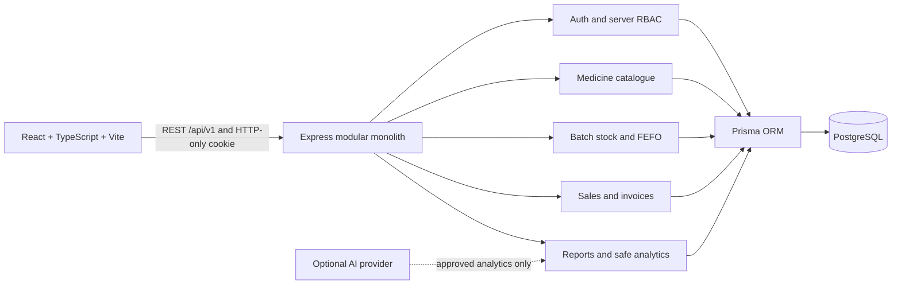

# System architecture

The API owns validation, authorization, inventory availability and calculations. A sale is processed in a serializable Prisma transaction. Batch updates are conditional, so stale requests cannot decrement a batch below zero. The browser only displays values and submits quantities; it is never the stock authority. UTC timestamps are stored in the database; pharmacy timezone is a setting.

The API reads `DATABASE_URL`, `JWT_SECRET`, `PORT`, `CLIENT_ORIGIN`, `COOKIE_SECURE`, and optional Gemini configuration from the server environment. Secrets must not be included in client bundles.
