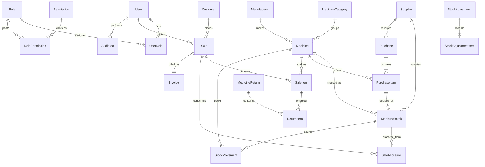

# Database model

The Prisma schema contains role/permission assignment, catalogue, suppliers/customers, purchases, batches, sale items and per-batch allocations, invoices/payments, returns, adjustments, stock movements, alerts/notifications, settings, tax configuration, audit log and AI insight records. Currency uses `Decimal`; batch identity is unique per medicine. The initial PostgreSQL migration includes database checks to prevent negative available and quarantined quantities. Migration generation and validation require Prisma CLI; applying it requires PostgreSQL.
